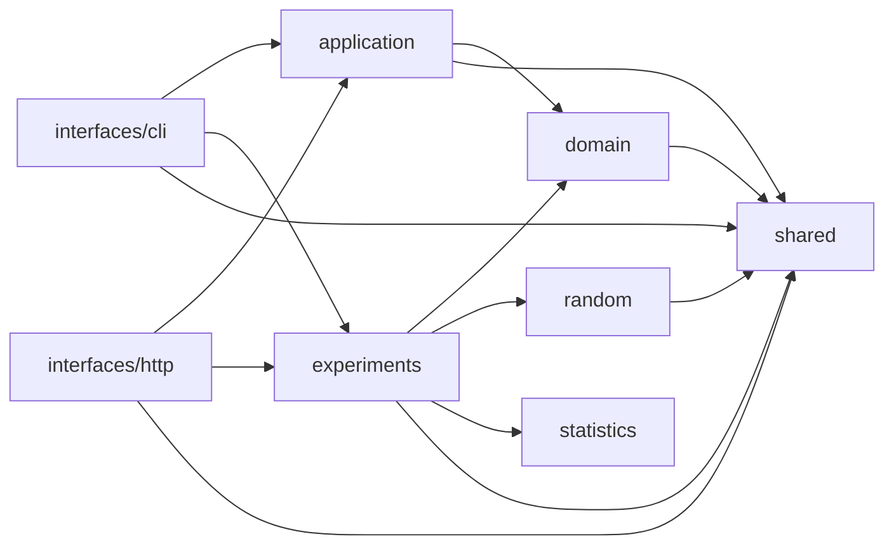

# Architecture

## Design goals

1. **Exactness:** integer results never pass through floating point.
2. **Bounded work:** every external input has an explicit limit.
3. **Reproducibility:** randomized runs are a pure function of their parameters and seed.
4. **Verifiability:** closed forms are tested against independent oracles.

## Module structure

```text
src/
├── index.js                     Public library surface
├── application.js               Use cases shared by the interfaces
├── domain/
│   ├── fibonacci.js             Fast doubling, exact and modular
│   ├── parity.js                Closed-form parity results
│   └── pisano.js                Pisano period
├── random/
│   └── mulberry32.js            Seeded generator, unbiased integers
├── statistics/
│   └── wilsonInterval.js        Wilson score interval
├── experiments/
│   ├── oddTermSearch.js         k-th odd term experiment
│   └── paritySampling.js        Monte Carlo experiment
├── interfaces/
│   ├── cli/run.js               Command parsing and JSON output
│   └── http/
│       ├── config.js            Environment validation
│       ├── router.js            Routes and query validation
│       └── server.js            Transport and security headers
└── shared/
    ├── limits.js                Input limits
    └── validation.js            Validation primitives
```



The repository contains no client code, so a `frontend/` and `backend/` split does not apply. A future client should live in `frontend/`, with the current service moving to `backend/`.

## Algorithms

### Fast doubling

With `F(0) = 0` and `F(1) = 1`:

```text
F(2k)   = F(k) * (2F(k+1) - F(k))
F(2k+1) = F(k)^2 + F(k+1)^2
```

The implementation scans the bits of `n` from most to least significant and performs `O(log n)` doubling steps. `F(n)` has `Θ(n)` bits and operand size doubles each step, so for superlinear multiplication the total cost is dominated by the last steps: `O(M(n))`. Modular evaluation keeps operands below `m`, giving `O(log n)` multiplications of `O(log m)`-bit integers.

### Parity

Modulo 2 the sequence from `F(1)` is `1, 1, 0, 1, 1, 0, ...`, because the pair `(1, 1)` recurs after three steps. Therefore:

```text
F(n) is even  <=>  3 divides n
even terms in F(1..n) = floor(n / 3)
odd terms in F(1..n)  = n - floor(n / 3)
index of the k-th odd term = k + floor((k - 1) / 2)
```

The last formula holds because odd terms occupy the indices `1, 2, 4, 5, 7, 8, ...`: every complete pair of odd terms before rank `k` skips one multiple of 3.

The original experiment ignored the two seed terms, so its target `k` maps to overall rank `k + 2`. For `k = 50`, the index is `52 + floor(51 / 2) = 77`, with `floor(77 / 3) = 25` even terms. `F(77)` is below `2^53`, so the original script's printed value was exact. `F(78)` is the largest Fibonacci number that fits in a safe integer.

### Pisano period

`π(m)` is the period of `F(n) mod m`. A state is the pair `(F(n), F(n+1)) mod m`. The transition is invertible, so the orbit returns to `(0, 1)`. The implementation uses `O(π(m))` time and `O(1)` space, and relies on the known bound `π(m) <= 6m`.

### Reproducible sampling

Indices are drawn uniformly from `1..N` with Mulberry32 and rejection sampling. Rejecting draws at or above the largest multiple of the range removes modulo bias, with fewer than two expected draws per sample. Parity is computed through `F(i) mod 2` rather than the closed form, so the experiment independently checks the theory.

The estimate is reported with a 95% Wilson score interval, which behaves better than the normal approximation for small samples and proportions near 0 or 1. Mulberry32 is a small non-cryptographic generator and does not produce every 32-bit output, which is acceptable for this use and unsuitable for security.

## Complexity summary

| Operation | Time | Space |
| --- | --- | --- |
| `fibonacci(n)` | `O(M(n))` | `O(n)` bits |
| `fibonacciModulo(n, m)` | `O(log n)` multiplications | `O(log m)` bits |
| `indexOfOddTerm(k)` | `O(1)` | `O(1)` |
| `searchOddTerm(k)` | `O(M(k))` | `O(k)` bits |
| `pisanoPeriod(m)` | `O(π(m))`, at most `6m` steps | `O(1)` |
| `sampleParity(s, N)` | `O(s log N)` multiplications | `O(1)` |

## Recommended deployment

```text
Internet -> TLS reverse proxy with rate limiting -> Node.js service on loopback
```

Computation runs synchronously on the event loop and is bounded by the input limits. For sustained public traffic, move experiments to `worker_threads`, and run several instances.

## Persistence

`db/schema.sql` is optional and is not used at runtime. `experiment_runs` holds run metadata, with one result table per experiment. `CHECK` constraints encode domain invariants, such as `even_count = sequence_length / 3` and `period <= 6 * modulus`.
